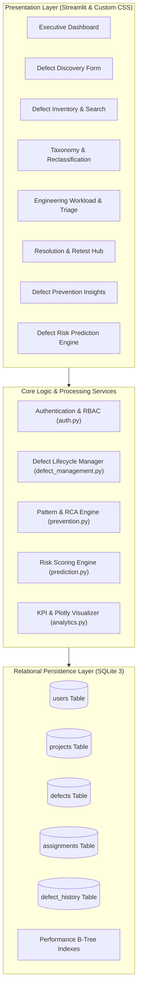
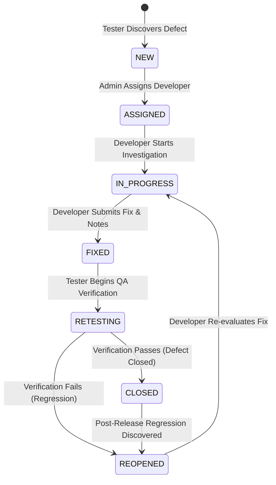
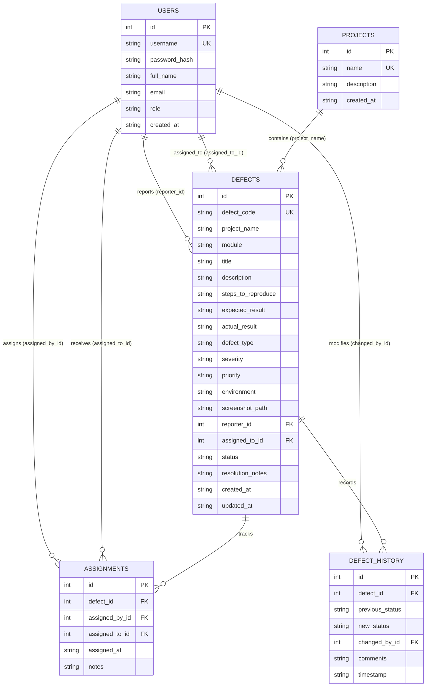
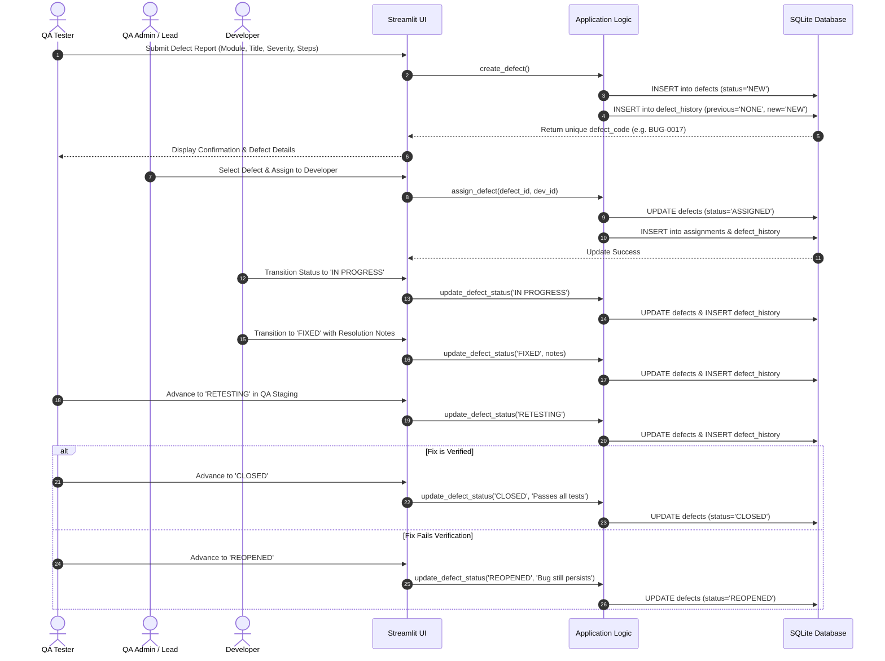

# SYSTEM ARCHITECTURE SPECIFICATION
## Software Defect Management and Prediction System

This document outlines the architectural blueprint, data flow, state machine, and entity relationships for the Software Defect Management and Prediction System.

---

### 1. High-Level Architectural Diagram

The system employs a multi-tiered architecture comprising a presentation layer powered by Streamlit, application services handling business logic, and a transactional SQLite database engine.

---

### 2. Defect Lifecycle Finite State Machine

The defect resolution workflow enforces a deterministic state machine. Out-of-order or invalid transitions are strictly rejected at the business logic layer.

---

### 3. Entity-Relationship (ER) Diagram

The relational schema ensures 3NF normalization, referential integrity via foreign key constraints, and fast query execution via multi-column indexing.

---

### 4. Defect Discovery & Resolution Sequence

The sequence diagram below displays the end-to-end interactions between the three user roles across a defect's lifespan.

---

### 5. Multi-Factor Defect Risk Prediction Algorithm

The prediction engine evaluates risk across five distinct software quality dimensions without opaque black-box assumptions:

$$\text{Risk Score } R_m = \min\left(100, \; 0.25 \cdot S_{\text{volume}} + 0.30 \cdot S_{\text{severity}} + 0.20 \cdot S_{\text{unresolved}} + 0.15 \cdot S_{\text{reopen}} + 0.10 \cdot S_{\text{recency}}\right)$$

#### Sub-Component Specifications:
1. **$S_{\text{volume}}$ (Weight: 25%):**
   $$\min\left(100, \; \frac{D_m}{5.0} \times 100\right)$$
   Measures absolute defect density; saturated at 5 defects.
2. **$S_{\text{severity}}$ (Weight: 30%):**
   $$\text{Raw}_{\text{sev}} = (C_m \times 4.0) + (H_m \times 2.5) + (M_m \times 1.0) + (L_m \times 0.25)$$
   $$S_{\text{severity}} = \min\left(100, \; \frac{\text{Raw}_{\text{sev}}}{10.0} \times 100\right)$$
3. **$S_{\text{unresolved}}$ (Weight: 20%):**
   $$S_{\text{unresolved}} = \left(\frac{U_m}{D_m}\right) \times 100 \times \min\left(1.0, \; \frac{U_m}{2.0}\right)$$
   Penalizes active unresolved technical debt.
4. **$S_{\text{reopen}}$ (Weight: 15%):**
   $$S_{\text{reopen}} = \min(100, \; R_m \times 50.0)$$
   Captures regression instability and fragile implementations.
5. **$S_{\text{recency}}$ (Weight: 10%):**
   $$S_{\text{recency}} = \min\left(100, \; \frac{\text{Recent}_m}{3.0} \times 100\right)$$
   Reflects defect clustering within the last 30 calendar days.

